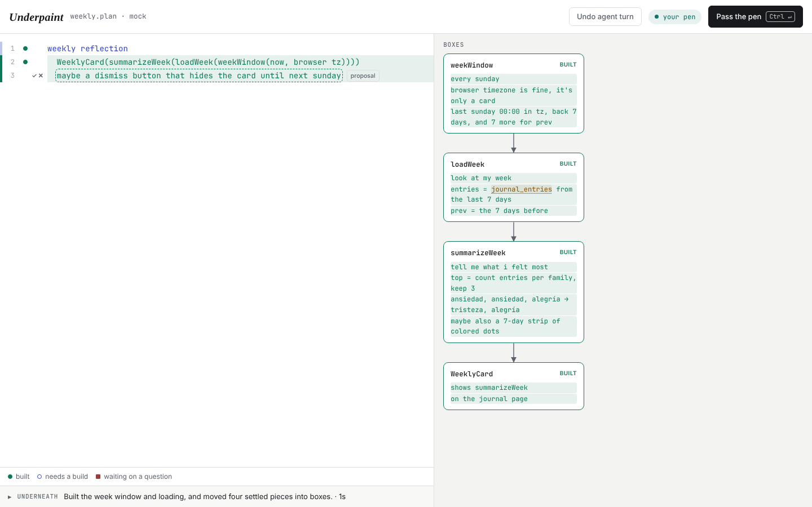

# Ogidoc

Build software with an agent by taking turns on one pseudocode file. There is no
chat. You write the idea the way it sits in your head; the agent edits the same file
in place, builds its best pick where a decision matters and shows the other ways right
there, and builds the real code underneath, test first, in small steps. Each line shows whether it is built, so
when the plan looks done, the software is done.

You work close to the code: the structure, the interfaces, where each thing lives.
Code is more precise than prose, so the plan can read like code that wouldn't compile
yet. The agent turns it into a program that does.



## Install

Node 22.18 or newer. Installing builds the editor once.

```bash
npm install -g github:brianjmeier/ogidoc
ogidoc install-skill        # optional: teach Claude Code and pi the tool
```

Run the same install again to update. Working on Ogidoc itself? Clone it and run
`npm install && npm link` inside the checkout instead, so `ogidoc` runs your copy,
and `npm run dev` to rebuild the editor as you change it.

## Run it

```bash
cd your-project
ogidoc --open
```

A session has a name. Leave it out and Ogidoc opens the one session in this folder, or
asks you to name a new one (the folder's name is the suggestion). `ogidoc checkout`
opens or starts the session called `checkout`.

| Option | |
| --- | --- |
| `--detach` | Run in the background and give the terminal back. |
| `--agent claude\|pi\|mock` | The agent that takes turns with you. Defaults to Claude Code if installed, else pi. |
| `--agent-arg <arg>` | Extra argument for the agent CLI, repeatable: `--agent-arg=--model --agent-arg=sonnet` |
| `--no-commit` | Don't commit each agent turn. |
| `--port <n>` | Defaults to 4747, or any free port. |
| `--open` | Open the editor in the browser. |

### Next to your chat

Start the session with `--detach` and keep using Claude Code or pi in the same
terminal for everything that isn't the plan: running tests, running the app, opening a
PR. Your chat can read the session but never takes a turn; turns stay between you, in
the editor, and the plan agent.

```bash
ogidoc --detach        # the session runs in the background
ogidoc list            # the sessions running on this machine
ogidoc status          # whose turn it is, and how the last turn went (--json for scripts)
ogidoc wait            # returns when the agent's turn ends, with its summary and commit
ogidoc stop            # stops it
```

Each command takes a session name; without one it uses the session started in this
folder, or the only one running.

To see it without an agent, run `npm run demo` in a clone (a scripted agent plays four
turns).

`ogidoc install-skill [claude|pi|both]` (default both) copies the skill into
`~/.claude/skills` and `~/.pi/agent/skills`, so an agent in a normal session knows the
tool and how to start it.

## How a session goes

- **Strict turns.** One side edits at a time. `⌘↵` (or `Ctrl ↵`) hands over. Your edits
  are the whole message; passing without edits means "go on". Code never changes on
  your turn.
- **No syntax.** Write any pseudocode. The agent follows your style and tells the
  editor what each line is: a proposal (Accept `⌥↵` or Reject `⌥⌫` at its end), an
  example (it becomes a test), or a real name from the codebase (underlined).
- **Options, not questions.** The agent decides the small things itself. Where a
  decision is expensive to undo or you'd notice it (a dependency, a data model, a
  public interface, behavior), it builds its pick and offers the other ways on the
  same lines. A bracket beside them switches between the ways in place (`‹ 1 of 2 ›`,
  or `⌥[` / `⌥]` with the caret in them), and **Use this** (`⌥↵`) locks one in.
  Hand over on another way and the agent builds that one.
- **Comments are yours.** Click a line number, or press `⌘⌥M` (`Ctrl+Alt+M`), to
  comment on a line. `⌥⌘↓` (`Alt+↓`) takes you to the next thing waiting on you:
  a choice, a proposal, or a comment the agent answered. The agent answers
  in the thread (`⌘↵` sends and hands over), folds the answer into the plan and
  resolves it.
- **Building underneath.** The agent builds what it understands in TDD baby steps.
  Margin marks say what's built, what needs a build, and what waits on a comment. The Underneath drawer lists the steps, files
  and checks of the last turn.
- **Boxes.** When a piece is settled, the agent moves it into a named box on the
  canvas and leaves a reference in the plan, so the plan stays short. Click a box, or
  Tab to it and press Enter, to edit it; that's how you disagree with an abstraction.
  In the plan Tab indents; press Esc first and Tab moves on.
- **Autocomplete.** On your turn the agent's guesses about your next lines show as
  ghost text. Tab accepts.
- **Done means done.** No open comments or options, every line and box built, checks
  green. Then **Delete the plan** removes the plan and its files in one commit; the
  code stays.
- **One commit per agent turn**, code and plan together. "Undo agent turn" reverts it,
  or `⌘Z` twice before you type anything.
  Code you change outside a turn is yours: the agent builds on it.

## Files

Everything stays plain text next to your code:

```
feature.plan                         the plan
.ogidoc/rules.md                 house rules for turns; edit freely
.ogidoc/feature/boxes/*.plan     one file per box
.ogidoc/feature/comments.json    comment threads, pinned to plan lines
.ogidoc/feature/state.json       what the editor knows per line (git-ignored)
```

## What the agent reads

- `agent/SKILL.md` teaches the agent what Ogidoc is: the shared plan, taking turns,
  building underneath, boxes, honest build status.
- `agent/rules.md` is the default for `.ogidoc/rules.md`: how big turns are, what
  to decide alone and what to offer as options, what earns a built mark.
- `agent/turn.md` is the prompt for one turn: the skill, the rules, the plan, the open
  comment threads and options, what the person changed, drift, and the JSON reply the editor
  expects.

Claude Code runs as `claude -p --output-format stream-json` with edit and shell tools
allowed; pi runs as `pi -p --mode json --no-session`. Both edit code with their own
tools and end their reply with the JSON block. Tool use streams to the editor as
activity.

## Layout

```
bin/ogidoc.ts     the CLI
src/session.ts        one session: the person's actions, the agent's turn, undo
src/plan.ts           the plan's lines, boxes, threads and choices through each edit
src/threads.ts        comment threads pinned to plan lines
src/choices.ts        the other ways the agent offered, cycled in place
src/plan-store.ts     where a plan lives on disk and how it is saved
src/turn-log.ts       one commit per turn, drift, revert (git, or nothing)
src/agents.ts         Claude Code, pi and mock adapters
src/prompt.ts         builds the turn prompt, parses the reply
src/server.ts         the local HTTP server and its event stream
src/types.ts          shapes shared by the server and the editor
src/shared/diff.ts    line diff used by server and browser
app/                  the editor (Solid + Kobalte, built by Vite into dist/web)
agent/                skill, rules and turn prompt
design/               the design walkthrough this was built from
```

## Tests

From a clone of this repository:

```bash
npm ci                # installs and builds
npm run typecheck     # server, tests and editor
npm test              # unit tests: diff, prompt, session with git, both adapters
npm run test:e2e      # the built editor in Chromium against the scripted agent
npm run test:real     # one real Claude Code turn in a temp repo (needs `claude`)
node test/real-agent.ts pi   # same with pi (needs pi with a provider configured)
```

The pi adapter is tested against pi's JSON event format with a stand-in binary, and
the real pi CLI was checked to accept its flags. A live pi turn needs credentials.
