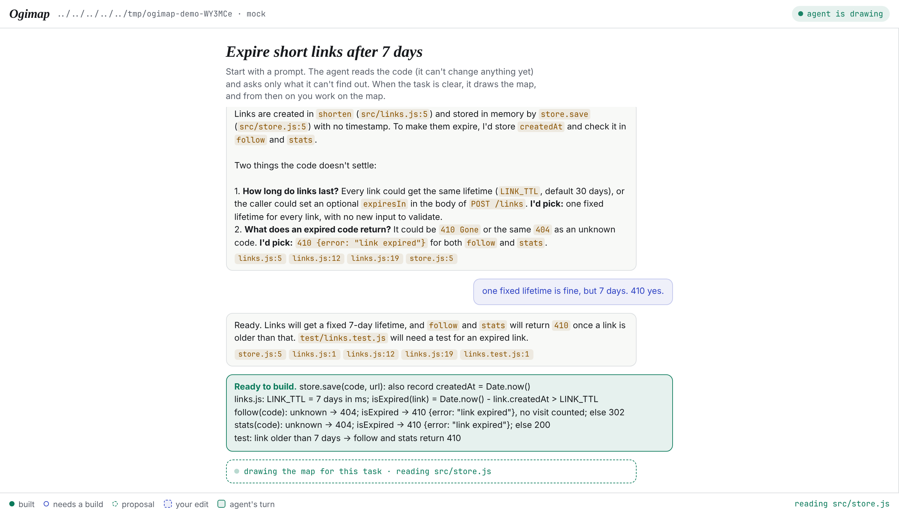
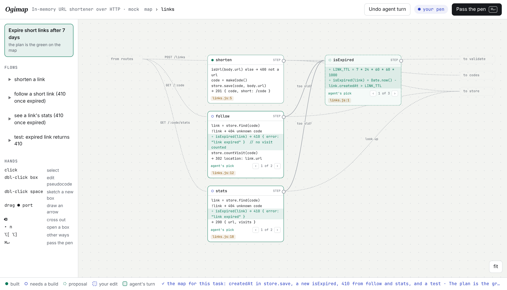
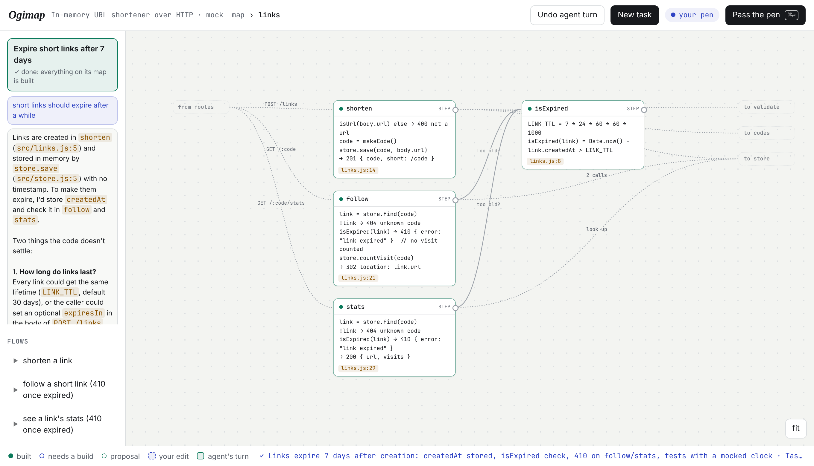

# Ogimap — change a codebase by editing its flow map

A proof of concept. Ogidoc goes from plan to code. Ogimap goes the other way round,
and then back again: it works on a codebase that already exists.

In a big codebase you can't start from a map of everything, so **a task starts as a
prompt**. The agent reads the code with you, read-only, and asks only what the code
can't tell it. When it decides the task is clear, it **draws the part of the flow map
the task touches, with the change on it as a plan**: boxes for the abstractions, each
with pseudocode, arrows for calls and data, flows you can play. From then on it is
Ogidoc mode. You rewrite pseudocode, sketch boxes, drag arrows, cross things out, pick
one of the ways the agent offered, and pass the pen. The agent builds it test first
and redraws the map true to the code. **After scoping there is no chat: your edits to
the map are the whole message.**

```bash
node labs/ogimap/ogimap.ts --demo            # a recorded real session replayed by a scripted agent, no API key
node labs/ogimap/ogimap.ts path/to/project   # Claude Code scopes (read-only), draws the map and builds
node labs/ogimap/ogimap.ts . --agent pi      # or pi, or any CLI: --agent-cmd "codex exec -s workspace-write"
```

Open <http://localhost:4848>. Node 22.18+, no install: it reuses Ogidoc's agent
adapters (`src/agents.ts`) and serves a page with no build step.

## A task

| | |
| --- | --- |
|  | **Scope.** "short links should expire after a while." The agent reads the code (with Claude Code, edits are off), points at it with `file:line` chips, and asks two questions, each with its pick. You answer. It decides the task is ready, writes a brief, and draws the map. |
|  | **The plan is the green.** Only what the task touches, plus one step of context, rendered as a map. `follow` and `stats` gain a line (`was` keeps what they do today), `isExpired` is a dashed proposal, and the decisions carry `‹ 1 of 3 ›` other ways. Edit any of it, or pass the pen with no edits to build it. |
|  | **Done** when nothing on the task's map waits for a build. The conversation folds into the task chip; the map stays as the code now is. |
|  | **Your edits are the message.** Hover the edit count to see exactly what the agent gets: a diff of the design (`CHANGE node…`, `NEW edge codes → store`), not prose. |
|  | **Options, not questions.** For an expensive or visible decision the agent builds its pick and offers the others on the box, each with its tradeoff as a pseudocode line. |

The demo replays a **real Claude Code session** recorded on `demo/shortener`: two
scoping messages, the task map, and the build (5 tests pass). The bottom bar says what
to try. The scripted agent plays the same turns whatever you type.

## The map grows, task by task

A task maps only what it touches, but the map belongs to the checkout: each task adds
to it. An agent never rewrites `.ogimap/map.json`. When a task is framed, it sees an
index of the map so far (ids, first lines, files) and writes the task's nodes to
`.ogimap/region.json`. Each turn after that, Ogimap writes the task's region there: the
nodes it works in, what contains them, what they contain, and what calls in or out.
The agent rewrites that file. Ogimap merges it back in code (`mergeRegion`): a returned
node replaces or adds, a node handed out and not returned is deleted, and the rest of
the map is untouched byte for byte.

Each box records the git blob hash of every file it points at, from when it last said
what the code does. A box whose files hash differently now (another task, a hand edit,
a rebase onto main) is marked **code changed**; the next turn's region includes it, and
the agent is told to re-read it. The editor opens on the task's part of the map; **Show
the whole map** switches.

## Every branch has its version of the map

`.ogimap/map.json` is committed with the code, one commit per turn, so a branch carries
its own version of the map. A checkout cut from main starts from main's map. A branch's
map rebases and merges onto main's like its code does: Ogimap registers a git merge
driver (`merge.ts`) in each checkout it runs in, and `.gitattributes` routes the map to
it. The driver merges three ways, field by field within each box: what one side changed
lands, and what either side added or deleted is added or deleted. When both sides
rewrote a box's pseudocode, the box keeps one and offers the other as another way,
marked to build, so the conflict shows as a choice instead of a merge marker. A running
Ogimap reads the map again when git changes it under it. What belongs to one checkout
(the task, the box layout, the server's port, a turn in flight) is git-ignored, so it
never reaches main.


## In Tend: a Worker scopes, Ogimap takes over

In [Tend](https://github.com/brianjmeier/tend), Ogimap lives in the **Workers**
station, next to its Ogidoc integration
(`examples/stations/brian/stations/workers/ogimap/`). The Worker's own conversation is
the scoping chat. When it decides the task is ready it calls
`ogimapStart({ title, prompt, brief })`. Workers starts Ogimap in the Worker's checkout
with `--task-file` (which skips straight to the map) and `--agent-cmd` set to Ogidoc's
turn bridge, so **the same Worker** draws the map and builds it, turn by turn
(`ogimapReply`). The Worker's board mirrors the map with the plan on it. Workers finds
the server through `--detach`, which prints `.ogimap/server.json` (port, pid) once
Ogimap listens.

## Hands

| | |
| --- | --- |
| click / shift-click | select boxes: what you're pointing at goes with the hand-over |
| double-click a box | edit its name, kind and pseudocode |
| double-click empty space | sketch a new box |
| drag a box's `●` port to another box | draw an arrow ("this should use that") |
| `⌫` | cross out the selected box or arrow; press again to restore |
| `▸ n` | open a box and see what's inside; arrows to the outside become ghost stubs |
| `‹ ›` or `⌥[` `⌥]` | cycle the other ways the agent offered |
| flows on the left | play a path: a token walks the arrows, boxes light up in order |
| `file:line` chips | open the real code beside the map |
| `⌘↵` | pass the pen. With no edits it means "go on". |
| Undo agent turn | `git revert` of the agent's commit (one commit per turn) |

## How it works

```
.ogimap/task.json  the task: prompt, the scoping conversation, the brief, its phase
.ogimap/map.json   nodes (id, name, parent, kind, pseudo[], was[], code anchors, status, ways[]),
                   edges (from, to, label, kind), flows (name, steps[])
.ogimap/layout.json  where you dragged the boxes; the rest is laid out in columns by what they use
.ogimap/rules.md     optional house rules, added to every turn
```

- **Scoping** (`scopePrompt`) runs the agent read-only and carries the conversation
  on (`--resume`). Each reply ends with `{ ready, title, refs, brief }`, and the agent
  decides `ready` itself.
- **Framing** (`framePrompt`) draws the task's part of the map from the brief and the
  conversation, with the change as a plan: `stale` + `was`, `proposal`, `ways`. Only
  `.ogimap/` may change; anything else is put back.
- **Mapping a whole codebase** (`--remap`, `mapPrompt`) asks the agent for two levels: whiteboard
  abstractions, and the functions that matter inside them. Pseudocode is 2–7 lines of
  "code that wouldn't compile", with real names kept real. Edges go between the most
  specific nodes, and the editor lifts them to whatever level you are looking at.
- **Your turn** is a draft copy of the map. On hand-over, `map.ts → intentOf` turns
  the draft into the agent's message: `CHANGE node` with a line diff of its pseudocode,
  `NEW node`, `NEW edge a → b`, `REMOVE …`, `picked way 2 of 3`, and the selection.
- **The agent's turn** (`turnPrompt`): build it test first, decide the small things
  itself, offer `ways` for expensive or visible decisions, keep your wording, then
  rewrite the whole map true to the code with stable ids. The server checks the map,
  gives the agent one chance to fix an invalid one, and commits code and map together.

```
ogimap.ts   CLI, HTTP + event stream, turns, git
map.ts      the map's shape, its check, and intentOf (draft → diff)
prompt.ts   the mapping and turn prompts, reply parsing
web/        the editor: SVG wires + HTML boxes, no framework
demo/       a small URL shortener, its map, and two recorded turns
```

`node --test labs/ogimap/map.test.ts` runs the unit tests.

## Prior art (researched Nov 2026)

Every piece exists somewhere. Nothing I found closes the whole loop: map an existing
codebase, show pseudocode, edit the map to change the code, then redraw.

- **Maps, read-only:** Windsurf/Cognition *Codemaps* (task-scoped maps with prose
  "trace guides"; changes still go through chat prompts), *CodeViz* (C4/UML maps, now a
  diagram editor, but edits don't reach the code), *DeepWiki*, *Noodles* (tree-sitter
  flow diagrams), GitDiagram, AppMap, Sourcetrail.
- **Pseudocode as the source:** *Huzzah* (`.hz` files kept in sync by an LLM). The
  closest in spirit, but for small new programs, with no map.
- **A higher layer drives the agent:** Kiro specs and Augment's living spec, but these
  are prose documents.
- **Two-way diagram ↔ code, no AI:** Microsoft's Code Canvas and Debugger Canvas, Code
  Bubbles, C-Chart. Visual languages like Enso and Node-RED are two-way only because the
  graph *is* the program.

So the gap is joining them over real code, with graph edits and pseudocode diffs as the
only input to the agent. That is what this proves out.

## What the POC showed, and what's next

What worked, with Claude Code on the demo project:
- the first map was right, and flagged a real gap: `→ code (no uniqueness check)`;
- a rewritten pseudocode box became tests plus code, and 7 tests pass;
- a module-level arrow was lowered to the right function edge (`makeCode → store.find`);
- a sketched box became a module with a child, and the IP was threaded through two
  layers I never mentioned;
- the agent offered alternatives as pseudocode, with tradeoffs as lines;
- ids stayed stable across turns.

Open questions:
- **Scale.** The agent rewrites the whole map each turn, which is fine for 20 nodes and
  not for 2,000. Next: map patches, a static-analysis skeleton (tree-sitter call graph)
  so anchors and edges are deterministic, and the LLM only for abstraction and
  pseudocode.
- **Drift.** Code changed outside Ogimap should mark boxes stale, as Ogidoc's drift does.
- **More visual verbs:** drag a box into another to move code between modules, split
  or merge boxes, reorder flow steps, pin an example (input → output) to a box as a test.
- **Comments as pins**, as in Ogidoc, for the rare question that needs words.
- **Tend.** The map is shapes and links, which is close to Tend's board. A station could
  host Ogimap with a session per box.
