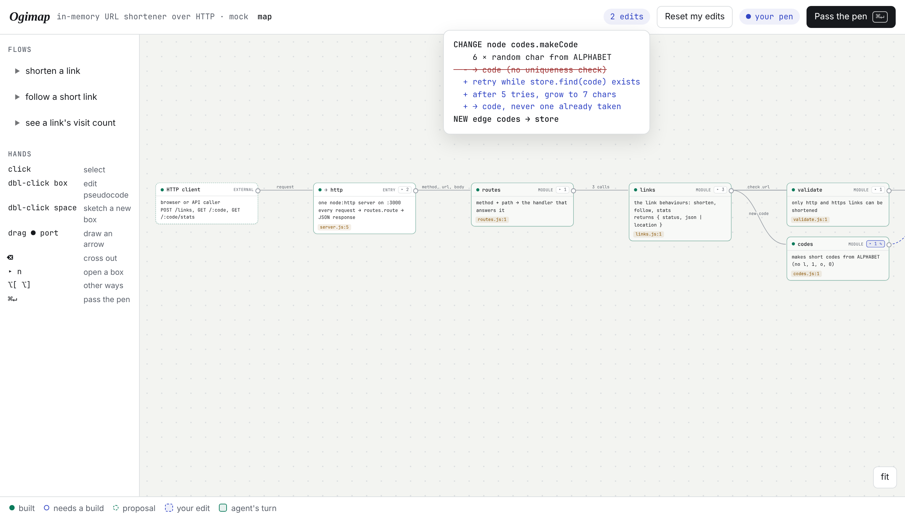
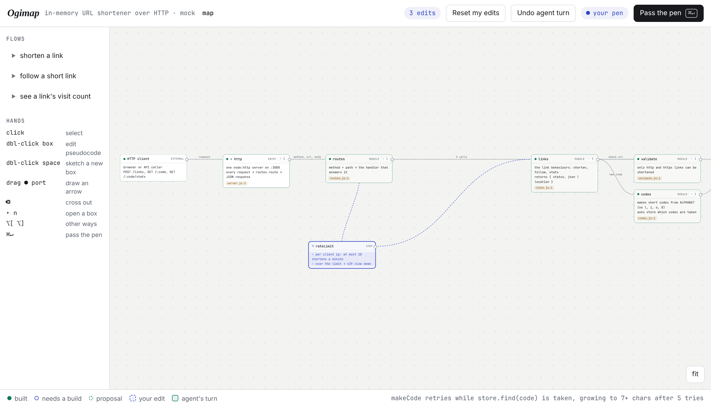
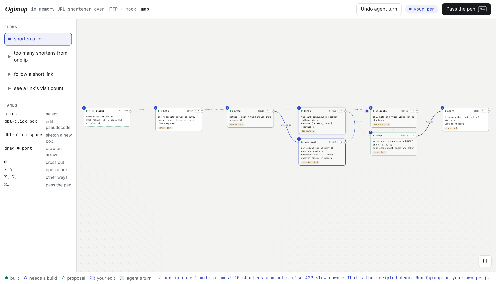
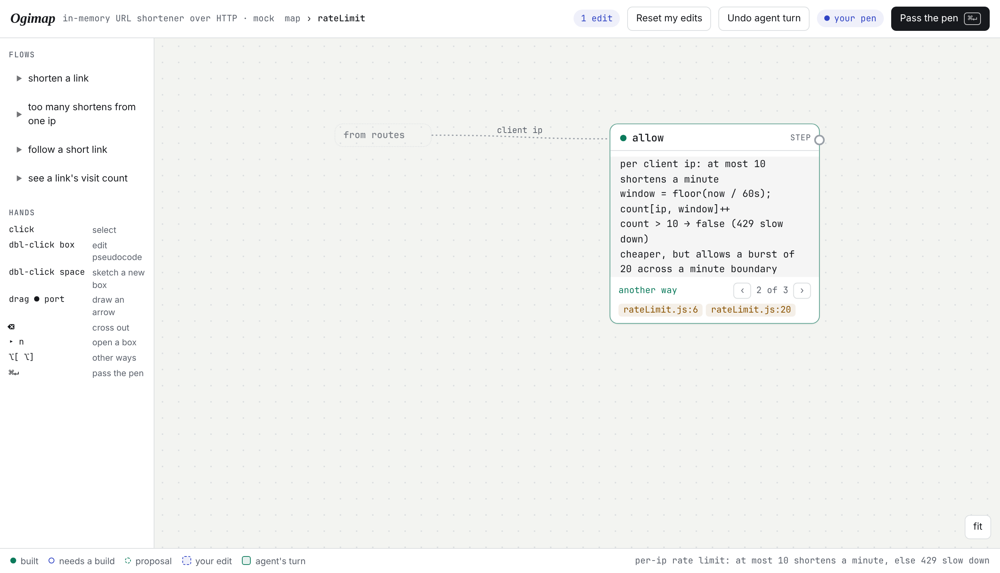

# Ogimap — change a codebase by editing its flow map

A proof of concept. Ogidoc goes from plan to code. Ogimap goes the other way round,
and then back again. An agent reads an existing codebase and draws a **flow map**:
boxes for its abstractions, each with **pseudocode**, arrows for calls and data, and
**flows** you can play, like a token travelling "shorten a link" from box to box.

To change the code you change the map: rewrite a box's pseudocode, sketch a new box,
drag an arrow, cross something out. Then hand over the pen. The agent changes the code
test first, redraws the map so it is true to the code again, and offers the other
ways it could have been built on the boxes themselves. You pick one or go on. There
is no chat box anywhere. **Your edits to the map are the whole message.**

```bash
node labs/ogimap/ogimap.ts --demo            # scripted agent, throwaway copy of the demo project, no API key
node labs/ogimap/ogimap.ts path/to/project   # Claude Code maps it, then takes your turns
node labs/ogimap/ogimap.ts . --agent pi      # or pi, or any CLI: --agent-cmd "codex exec -s workspace-write"
```

Open <http://localhost:4848>. Node 22.18+, no install: it reuses Ogidoc's agent
adapters (`src/agents.ts`) and serves a no-build page.

## A session

| You | What the agent reads |
| --- | --- |
|  | Open `▸ codes`, rewrite `makeCode` so a code is never reused, drag an arrow from codes to store. Hover the edit count to see exactly what the agent will get: a diff of the design, not prose. |
|  | Double-click empty space to sketch `rateLimit`, then wire `routes → rateLimit → links`. Dashed blue means it is yours and not built yet. |
|  | After the turn, `rateLimit` is real: the client IP is threaded through `server → route`, there are tests, and the "shorten a link" flow now passes through it. |
|  | The agent built a sliding window and offers a fixed window, and trusting `x-forwarded-for`, as other ways on the box, each with its tradeoff as a pseudocode line. `‹ 2 of 3 ›` then `⌘↵` builds that way instead. |

Both turns in the demo were recorded from **real Claude Code turns** on this project.
The scripted agent replays them, so it plays the same two turns whatever you edit. The
bottom bar says what to try.

## Hands

| | |
| --- | --- |
| click / shift-click | select boxes: what you're pointing at goes with the hand-over |
| double-click a box | edit its name, kind and pseudocode |
| double-click empty space | sketch a new box |
| drag a box's `●` port to another box | draw an arrow ("this should use that") |
| `⌫` | cross out the selected box or arrow; press again to restore |
| `▸ n` | open a box and see what's inside; arrows to the outside become ghost stubs |
| `‹ ›` or `⌥[` `⌥]` | cycle the other ways the agent offered |
| flows on the left | play a path: a token walks the arrows, boxes light up in order |
| `file:line` chips | open the real code beside the map |
| `⌘↵` | pass the pen. With no edits it means "go on". |
| Undo agent turn | `git revert` of the agent's commit (one commit per turn) |

## How it works

```
.ogimap/map.json   nodes (id, name, parent, kind, pseudo[], code anchors, status, ways[]),
                   edges (from, to, label, kind), flows (name, steps[])
.ogimap/layout.json  where you dragged the boxes; the rest is laid out in columns by what they use
.ogimap/rules.md     optional house rules, added to every turn
```

- **Mapping** (`prompt.ts → mapPrompt`) asks the agent for two levels: whiteboard
  abstractions, and the functions that matter inside them. Pseudocode is 2–7 lines of
  "code that wouldn't compile", with real names kept real. Edges go between the most
  specific nodes, and the editor lifts them to whatever level you are looking at.
- **Your turn** is a draft copy of the map. On hand-over, `map.ts → intentOf` turns
  the draft into the agent's message: `CHANGE node` with a line diff of its pseudocode,
  `NEW node`, `NEW edge a → b`, `REMOVE …`, `picked way 2 of 3`, and the selection.
- **The agent's turn** (`turnPrompt`): build it test first, decide the small things
  itself, offer `ways` for expensive or visible decisions, keep your wording, then
  rewrite the whole map true to the code with stable ids. The server checks the map,
  gives the agent one chance to fix an invalid one, and commits code and map together.

```
ogimap.ts   CLI, HTTP + event stream, turns, git
map.ts      the map's shape, its check, and intentOf (draft → diff)
prompt.ts   the mapping and turn prompts, reply parsing
web/        the editor: SVG wires + HTML boxes, no framework
demo/       a small URL shortener, its map, and two recorded turns
```

`node --test labs/ogimap/map.test.ts` runs the unit tests.

## Prior art (researched Nov 2026)

Every piece exists somewhere. Nothing I found closes the whole loop: map an existing
codebase, show pseudocode, edit the map to change the code, then redraw.

- **Maps, read-only:** Windsurf/Cognition *Codemaps* (task-scoped maps with prose
  "trace guides"; changes still go through chat prompts), *CodeViz* (C4/UML maps, now a
  diagram editor, but edits don't reach the code), *DeepWiki*, *Noodles* (tree-sitter
  flow diagrams), GitDiagram, AppMap, Sourcetrail.
- **Pseudocode as the source:** *Huzzah* (`.hz` files kept in sync by an LLM). The
  closest in spirit, but for small new programs, with no map.
- **A higher layer drives the agent:** Kiro specs and Augment's living spec, but these
  are prose documents.
- **Two-way diagram ↔ code, no AI:** Microsoft's Code Canvas and Debugger Canvas, Code
  Bubbles, C-Chart. Visual languages like Enso and Node-RED are two-way only because the
  graph *is* the program.

So the gap is joining them over real code, with graph edits and pseudocode diffs as the
only input to the agent. That is what this proves out.

## What the POC showed, and what's next

What worked, with Claude Code on the demo project:
- the first map was right, and flagged a real gap: `→ code (no uniqueness check)`;
- a rewritten pseudocode box became tests plus code, and 7 tests pass;
- a module-level arrow was lowered to the right function edge (`makeCode → store.find`);
- a sketched box became a module with a child, and the IP was threaded through two
  layers I never mentioned;
- the agent offered alternatives as pseudocode, with tradeoffs as lines;
- ids stayed stable across turns.

Open questions:
- **Scale.** The agent rewrites the whole map each turn, which is fine for 20 nodes and
  not for 2,000. Next: map patches, a static-analysis skeleton (tree-sitter call graph)
  so anchors and edges are deterministic, and the LLM only for abstraction and
  pseudocode.
- **Drift.** Code changed outside Ogimap should mark boxes stale, as Ogidoc's drift does.
- **More visual verbs:** drag a box into another to move code between modules, split
  or merge boxes, reorder flow steps, pin an example (input → output) to a box as a test.
- **Comments as pins**, as in Ogidoc, for the rare question that needs words.
- **Tend.** The map is shapes and links, which is close to Tend's board. A station could
  host Ogimap with a session per box.
